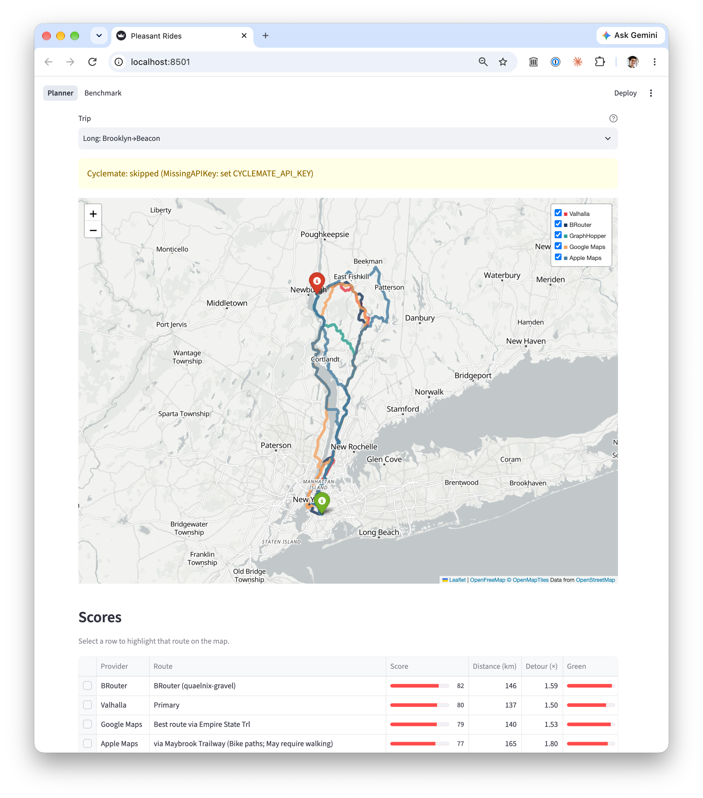

# Pleasant Ride Planner

Mapping apps are good at getting you from place to place, but they generally optimize for minimum travel time. For travel by bike, that isn't always desirable. This repository is exploring what it would mean to find the "most pleasant" bike route from A to B. This applies within cities/towns, and also in more rural areas.



It's at [pleasant-rides.afeld.me](https://pleasant-rides.afeld.me), where anyone can see the sample trips and the bike lanes. Planning your own trips is by invitation; to run it yourself, see [Running](#running).

## Working definition

A "pleasant" bike ride is:

- **Enjoyable**
  - Things to look at, such as:
    - Nature
    - Good views
  - Points of interest
  - Quiet
- **Easy**
  - Avoids steep climbs/descents
  - Simple navigation
    - Not many turns
  - Smooth-ish surface, such as:
    - Pavement
    - Boardwalks (where cycling is permitted)
    - Crushed gravel
  - Minimal walking required, such as:
    - One-ways
    - Stairs
- **Safe**
  - Minimal:
    - Vehicular traffic
    - Intersections
  - If there _are_ motor vehicles:
    - A low speed limit
    - The fewer lanes, the better
  - Not _too_ remote
    - Theoretically walkable to somewhere you can get help if you need.

A pleasant ride is _not necessarily_ the most direct, but it shouldn't add a ton of time over the most direct route, either. Similarly, a pleasant route isn't necessarily the most popular one.

## Running

1. Install [uv](https://docs.astral.sh/uv/getting-started/installation/).
1. Install dependencies:

   ```sh
   uv sync
   ```

1. Create a `.env` file with API keys for the providers that need them. Any provider without a key is skipped (with a warning in the app).

   ```sh
   GOOGLE_MAPS_API_KEY=...
   GRAPHHOPPER_API_KEY=...
   CYCLEMATE_API_KEY=...
   MAPILLARY_ACCESS_TOKEN=...
   ```

   Valhalla and BRouter use public servers and don't need keys (or run BRouter yourself; see [Local BRouter](#local-brouter)). The Apple Maps provider needs macOS with the Xcode command line tools (`xcode-select --install`); it compiles a small Swift program the first time it runs. Scoring also uses Valhalla's public server, plus [Overture Maps](https://overturemaps.org/) data for scenery, points of interest, and remoteness, which is downloaded from its public S3 bucket. `MAPILLARY_ACCESS_TOKEN` is for previewing a selected route with [Mapillary](https://www.mapillary.com/)'s street-level photos; create one by [registering an app](https://www.mapillary.com/dashboard/developers). It's also sent to the browser, which loads the photos itself.

1. Start the app:

   ```sh
   uv run --env-file .env streamlit run app.py
   ```

   It opens at http://localhost:8501. The app reruns when you save `app.py`, its pages under `app_pages/`, or anything under `pleasant_rides/`. Routes are cached to disk (in `~/.streamlit/cache`) per provider (and its settings) and origin/destination, so they're kept across restarts. To refetch them, use "Clear cache" from the app's ⋮ menu.

## Local BRouter

BRouter's public server is free but busy: long routes sometimes get killed, and the app waits between requests to be polite. To run your own in [Docker](https://docs.docker.com/get-started/get-docker/):

1. Start it:

   ```sh
   docker compose up
   ```

   The first time, this builds BRouter from source with its routing data for the area around New York City (~120 MB), which takes a few minutes. After that it starts in a few seconds. It's the same image the deployed app uses (see [`brouter/Dockerfile`](brouter/Dockerfile)). For other areas, set `BROUTER_TILES` to [tiles](https://brouter.de/brouter/segments4/) separated by spaces and rebuild, e.g. `BROUTER_TILES="W75_N40 W80_N40" docker compose up --build`.

1. Add this to your `.env`:

   ```sh
   BROUTER_URL=http://localhost:17777/brouter
   ```

   Routes from it are cached separately from the public server's.

To stop it, run `docker compose down`. To get fresh data, which the public server updates weekly, run `docker compose build --no-cache`.

## Deploying

The app runs on [Fly.io](https://fly.io/), which stops it when nobody's connected and starts it on the next request. A volume keeps Streamlit's disk cache across restarts. It routes with its own BRouter, a second Fly app (`pleasant-rides-brouter`, in [`brouter/`](brouter/)) that has no public IP: the app reaches it over Fly's private network through [Flycast](https://fly.io/docs/networking/flycast/), which also starts it on demand. On deployed copies, anyone can see the sample trips and the bike lanes, since those only ever fetch the same things, which are then cached. Planning your own trip, running the benchmark, and previewing street-level photos require signing in with Google, and only the sign-in client's test users get in (see [`pleasant_rides/login.py`](pleasant_rides/login.py)), since those could make any number of requests, spending the API keys and the public servers' capacity. The Google Cloud project (`pleasant-rides`) and the `pleasant-rides.afeld.me` DNS record (in Cloudflare) are managed with [Terraform](https://developer.hashicorp.com/terraform), except for the sign-in client, which Terraform can't create. Terraform also caps Google's Routes API at 64 requests a day, which keeps it under $20 a month even at its higher rate (see [`terraform/quota.tf`](terraform/quota.tf)). Past the cap, the Google Maps provider fails until the next day (Pacific time), and the app shows that as a warning.

1. Apply the Terraform config, signed in to gcloud as an owner of the project (`--no-activate` leaves your other gcloud configurations alone):

   ```sh
   gcloud auth login --no-activate <your Google account>
   ```

   ```sh
   export GOOGLE_OAUTH_ACCESS_TOKEN=$(gcloud auth print-access-token <your Google account>)
   ```

   For the DNS record, [create a Cloudflare API token](https://dash.cloudflare.com/profile/api-tokens) with the "Edit zone DNS" template, limited to the `afeld.me` zone:

   ```sh
   export CLOUDFLARE_API_TOKEN=<token>
   ```

   Terraform needs two APIs turned on before it can manage the rest, so turn those on with gcloud:

   ```sh
   gcloud services enable cloudresourcemanager.googleapis.com apikeys.googleapis.com --project pleasant-rides --account <your Google account>
   ```

   ```sh
   terraform -chdir=terraform init && terraform -chdir=terraform apply
   ```

   The state is kept locally (and ignored by Git), since it includes the Maps key itself.

1. In the [Google Auth Platform](https://console.cloud.google.com/auth/overview?project=pleasant-rides):
   1. Under Audience, choose External, leave it in Testing, and add the people who should have access as test users. Testing mode only lets test users sign in, so it's the allowlist: don't publish the app, or any Google account could get in.
   1. Under Clients, create a Web application client with the authorized redirect URI `https://pleasant-rides.afeld.me/oauth2callback`.
1. Create `.streamlit/secrets.toml` (ignored by Git) with the client's ID and secret:

   ```toml
   [auth]
   redirect_uri = "https://pleasant-rides.afeld.me/oauth2callback"
   cookie_secret = "<a long random string, e.g. from `openssl rand -hex 32`>"
   client_id = "<client ID>"
   client_secret = "<client secret>"
   server_metadata_url = "https://accounts.google.com/.well-known/openid-configuration"
   ```

1. Install [flyctl](https://fly.io/docs/flyctl/install/), sign in (`fly auth login`), and create the app. Everything else about it is in [`fly.toml`](fly.toml).

   ```sh
   fly apps create pleasant-rides
   ```

   ```sh
   fly certs add pleasant-rides.afeld.me
   ```

1. Create and deploy BRouter, with only a private IP:

   ```sh
   fly apps create pleasant-rides-brouter
   ```

   ```sh
   fly ips allocate-v6 --private --app pleasant-rides-brouter
   ```

   ```sh
   fly deploy brouter --ha=false
   ```

1. Set the secrets: the API keys and tokens from `.env` (only the `*_KEY` and `*_TOKEN` variables, since e.g. `BROUTER_URL` points at your local BRouter), and `secrets.toml`, which Fly needs base64-encoded:

   ```sh
   grep -E '_(KEY|TOKEN)=' .env | fly secrets import --stage
   ```

   ```sh
   fly secrets set STREAMLIT_SECRETS="$(base64 < .streamlit/secrets.toml)"
   ```

1. Deploy the first time, which also creates the cache volume. `--ha=false` keeps it to one machine, since the cache volume can only be attached to one, and one is plenty:

   ```sh
   fly deploy --ha=false
   ```

After that, pushes to `main` deploy both apps automatically, through Fly's GitHub integration (set up in each app's dashboard: [the app](https://fly.io/apps/pleasant-rides) and [BRouter](https://fly.io/apps/pleasant-rides-brouter)). Later deploys update the existing machines, so they don't need `--ha=false`. BRouter's routing data is built into its image, so to get fresh data (the public server updates it weekly), redeploy it without the build cache: `fly deploy brouter --no-cache`.

To change who has access, edit the [test users](https://console.cloud.google.com/auth/audience?project=pleasant-rides). It takes effect on their next sign-in, without a deploy.

## Benchmarking

The app's Benchmark page compares providers' routing parameters. It scores each variant's first route on a few sample trips. To try new parameters, add a variant to `VARIANTS` in [`pleasant_rides/benchmark/variants.py`](pleasant_rides/benchmark/variants.py). Results come from the providers' live servers, so they can drift; compare against the baselines (the `(current)` variants) from the same run. It also shows how long each variant's provider took to return routes; for cached routes, that's from when they were fetched.

## Bike lanes

The app's Bike lanes page compares New York City's bike lanes in [OpenStreetMap](https://www.openstreetmap.org/) (from the [Overpass API](https://wiki.openstreetmap.org/wiki/Overpass_API)), [Overture Maps](https://overturemaps.org/), and NYC DOT's [bike routes](https://data.cityofnewyork.us/d/mzxg-pwib) on NYC Open Data: how many miles of each type of lane each has, how much of each source's lanes the others have too, and a map of them. Each source is fetched once for the whole city and cached to disk; the first load can take a minute or two, since the public Overpass servers are often busy.

## Testing

```sh
uv run pytest
uv run pyright
```

The tests don't make network requests. GitHub Actions runs both on pushes to `main` and on pull requests.

## See also

- [Cyclemate](https://cyclemate.club/)
  - [Methodology](https://cyclemate.club/supersafe)
