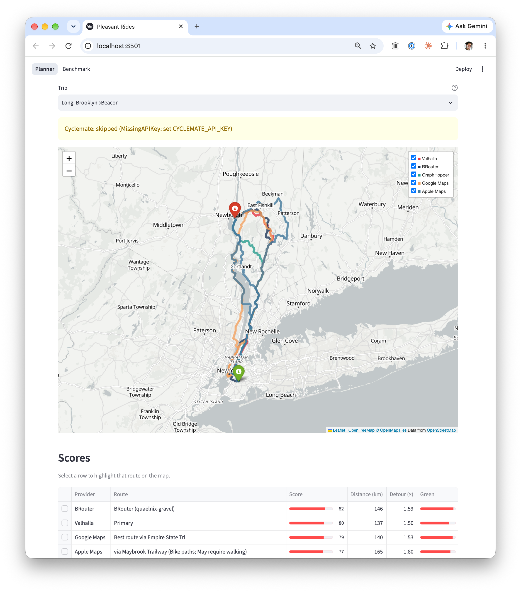

# Pleasant Ride Planner

Mapping apps are good at getting you from place to place, but they generally optimize for minimum travel time. For travel by bike, that isn't always desirable. This repository is exploring what it would mean to find the "most pleasant" bike route from A to B. This applies within cities/towns, and also in more rural areas.



There isn't a public instance of the app/analysis at this point - see [Running](#running) to get it working on your computer.

## Working definition

A "pleasant" bike ride is:

- **Enjoyable**
  - Things to look at, such as:
    - Nature
    - Good views
  - Points of interest
  - Quiet
- **Easy**
  - Avoids steep climbs/descents
  - Simple navigation
    - Not many turns
  - Smooth-ish surface, such as:
    - Pavement
    - Boardwalks (where cycling is permitted)
    - Crushed gravel
  - Minimal walking required, such as:
    - One-ways
    - Stairs
- **Safe**
  - Minimal:
    - Vehicular traffic
    - Intersections
  - If there _are_ motor vehicles:
    - A low speed limit
    - The fewer lanes, the better
  - Not _too_ remote
    - Theoretically walkable to somewhere you can get help if you need.

A pleasant ride is _not necessarily_ the most direct, but it shouldn't add a ton of time over the most direct route, either. Similarly, a pleasant route isn't necessarily the most popular one.

## Running

1. Install [uv](https://docs.astral.sh/uv/getting-started/installation/).
1. Install dependencies:

   ```sh
   uv sync
   ```

1. Create a `.env` file with API keys for the providers that need them. Any provider without a key is skipped (with a warning in the app).

   ```sh
   GOOGLE_MAPS_API_KEY=...
   GRAPHHOPPER_API_KEY=...
   CYCLEMATE_API_KEY=...
   ```

   Valhalla and BRouter use public servers and don't need keys (or run BRouter yourself; see [Local BRouter](#local-brouter)). The Apple Maps provider needs macOS with the Xcode command line tools (`xcode-select --install`); it compiles a small Swift program the first time it runs. Scoring also uses Valhalla's public server, plus [Overture Maps](https://overturemaps.org/) data for scenery, points of interest, and remoteness, which is downloaded from its public S3 bucket.

1. Start the app:

   ```sh
   uv run --env-file .env streamlit run app.py
   ```

   It opens at http://localhost:8501. The app reruns when you save `app.py`, its pages under `app_pages/`, or anything under `pleasant_rides/`. Routes are cached to disk (in `~/.streamlit/cache`) per provider (and its settings) and origin/destination, so they're kept across restarts. To refetch them, use "Clear cache" from the app's ⋮ menu.

## Local BRouter

BRouter's public server is free but busy: long routes sometimes get killed, and the app waits between requests to be polite. To run your own in [Docker](https://docs.docker.com/get-started/get-docker/):

1. Start it:

   ```sh
   docker compose up
   ```

   The first time, this builds BRouter from source and downloads its routing data for the area around New York City (~120 MB), which takes a minute or two. After that it starts in a few seconds. For other areas, set `BROUTER_TILES` to [tiles](https://brouter.de/brouter/segments4/) separated by spaces, e.g. `BROUTER_TILES="W75_N40 W80_N40"`.

1. Add this to your `.env`:

   ```sh
   BROUTER_URL=http://localhost:17777/brouter
   ```

   Routes from it are cached separately from the public server's.

To stop it, run `docker compose down`. To wipe it, including the downloaded data (e.g. to get fresh data, which the public server updates weekly), run `docker compose down -v --rmi all`.

## Benchmarking

The app's Benchmark page compares providers' routing parameters. It scores each variant's first route on a few sample trips. To try new parameters, add a variant to `VARIANTS` in [`pleasant_rides/benchmark/variants.py`](pleasant_rides/benchmark/variants.py). Results come from the providers' live servers, so they can drift; compare against the baselines (the `(current)` variants) from the same run. It also shows how long each variant's provider took to return routes; for cached routes, that's from when they were fetched.

## Bike lanes

The app's Bike lanes page compares New York City's bike lanes in [OpenStreetMap](https://www.openstreetmap.org/) (from the [Overpass API](https://wiki.openstreetmap.org/wiki/Overpass_API)), [Overture Maps](https://overturemaps.org/), and NYC DOT's [bike routes](https://data.cityofnewyork.us/d/mzxg-pwib) on NYC Open Data: how many kilometers of each type of lane each has, how much of each source's lanes the others have too, and a map of them. Each source is fetched once for the whole city and cached to disk; the first load can take a minute or two, since the public Overpass servers are often busy.

## Testing

```sh
uv run pytest
uv run pyright
```

The tests don't make network requests. GitHub Actions runs both on pushes to `main` and on pull requests.

## See also

- [Cyclemate](https://cyclemate.club/)
  - [Methodology](https://cyclemate.club/supersafe)
